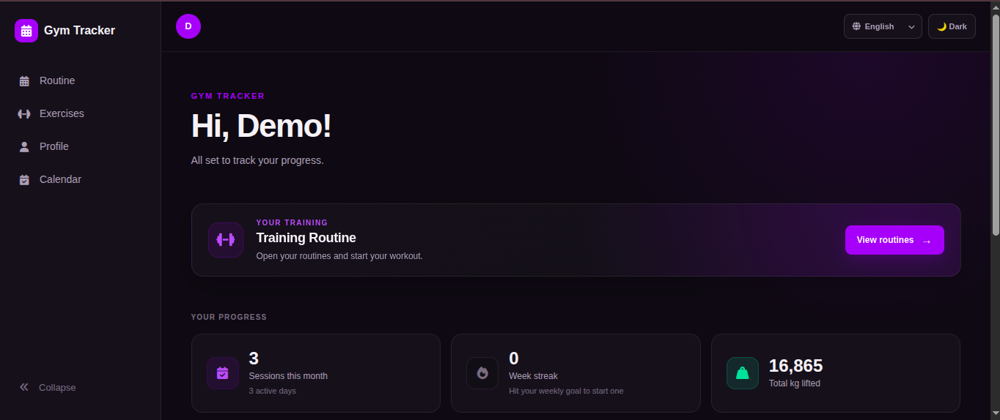
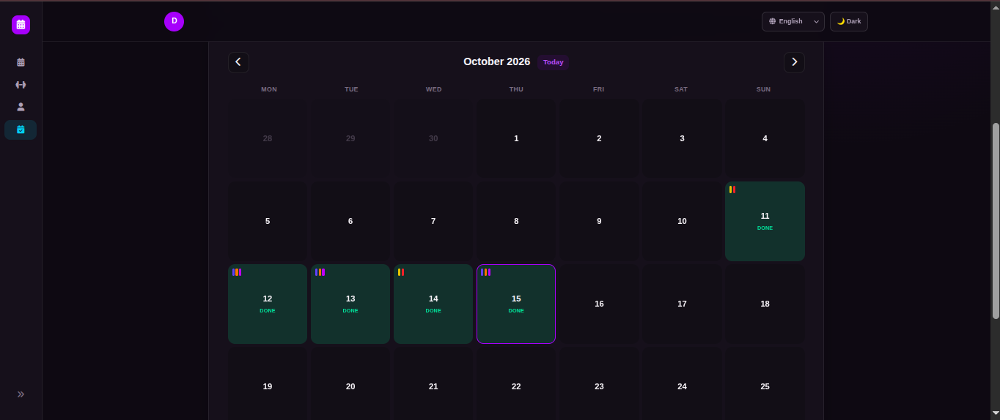
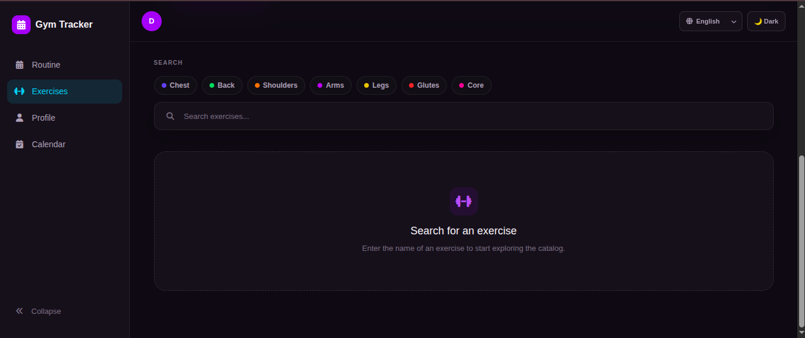
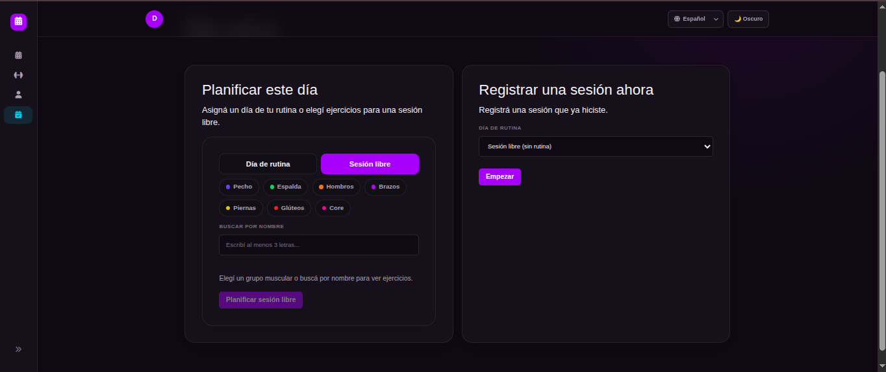
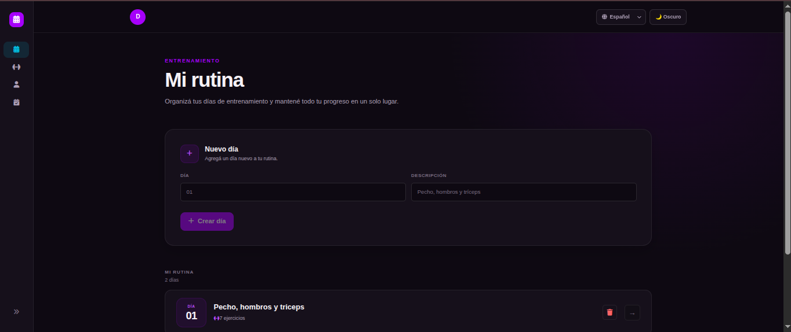
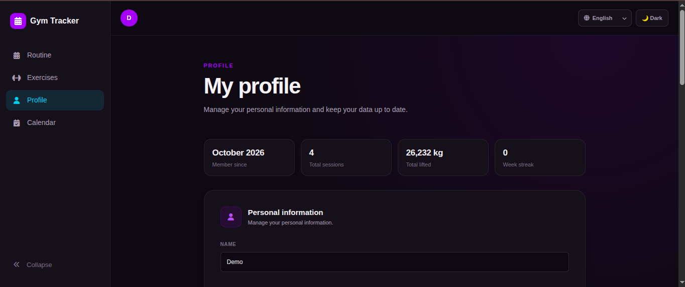
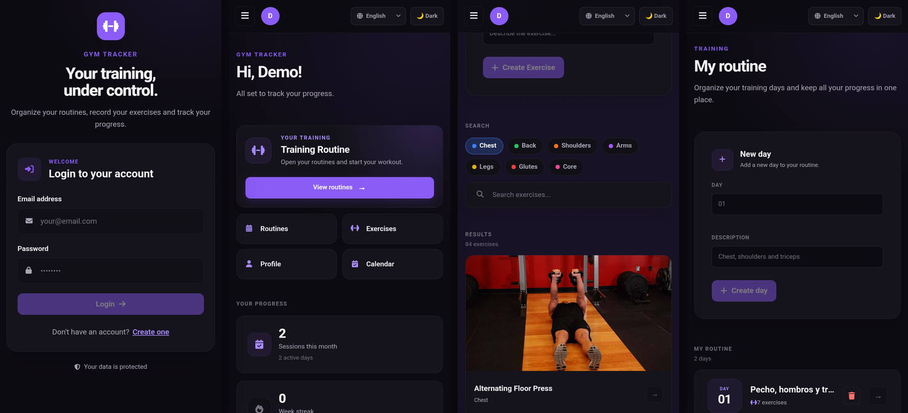

# Gym App — Web client 🏋️‍♀️

React web app for tracking workouts: build routines, plan sessions, log what you lifted and watch your progress on a color-coded calendar. Available in English, Spanish, Portuguese and French.

**Live demo:** https://gym-app-4jtc.onrender.com

> The API runs on Render's free tier and goes to sleep after 15 minutes without traffic. If nobody used the app recently, the first request (login included) can take about a minute while it wakes up. After that it is fast.

API repository: [Gym-App backend](https://github.com/SamiVijarra/Gym-App)

## Screenshots

|                                                              |                                                        |
| ------------------------------------------------------------ | ------------------------------------------------------ |
|                            |              |
| **Home**: stats, weekly streak, quick access                 | **Calendar**: color marks per muscle group on each day |
|                  |      |
| **Exercise catalog**: search by name, muscle or muscle group | **Free session**: pick a group, then add exercises     |
|                      |                |
| **Routine** (Spanish interface)                              | **Profile**: summary, default weekly goal, password    |

On a phone:



## Features

- **Exercise catalog**: 873 exercises plus your own. Search by name, by muscle or by muscle group, in any of the four languages (typing "piernas", "jambes" or "legs" finds the same exercises), or tap a muscle group button.
- **Routines**: training days with exercises and sets. Finishing a session keeps the routine up to date with your latest numbers.
- **Calendar** with a month view and a day view:
    - plan a routine day, or a **free session** by picking exercises ahead of time;
    - log a session on the spot, or complete a planned one;
    - **color marks per muscle group** on each day, with a legend.
- **Pick exercises by muscle group**: choose Chest, Back, Glutes... see only those exercises, add them, then switch group to add more.
- **Progress**: per-exercise chart (max weight or total volume), monthly stats by muscle group, weekly goal and a weekly streak on the home page.
- **Profile**: personal data, a default weekly goal and password change.
- **Four languages** (English, Spanish, Portuguese, French) with a selector on every screen. See [Languages](#languages).
- **Light and dark theme**, responsive layout with a collapsible sidebar on desktop and a drawer on mobile.
- Confirmation dialogs before every delete, and field-level validation on most forms.

## Stack

React 19, Vite 8, Redux Toolkit, React Router 6, styled-components, i18next, TypeScript (migrating gradually, `allowJs`), Axios, Recharts, date-fns, SweetAlert2.

## Getting started

Requirements: Node.js `^20.19.0` or `>=22.12.0` (Vite 8) and the API running (see the API repository).

```bash
npm install
cp .env.template .env      # set VITE_API_URL to the API address
npm run dev
```

| Variable       | Description                                                                        |
| -------------- | ---------------------------------------------------------------------------------- |
| `VITE_API_URL` | Base URL of the API, without a trailing slash, for example `http://localhost:3000` |

`VITE_API_URL` is read **when the app is built**, not when it runs. If you change it in a deployed site, build it again.

The API must allow this origin in its `CORS_ORIGIN` setting (Vite runs on `http://localhost:5173` by default).

## Scripts

| Command           | What it does                       |
| ----------------- | ---------------------------------- |
| `npm run dev`     | Development server                 |
| `npm run build`   | Production build into `dist/`      |
| `npm run preview` | Serve the production build locally |
| `npm run lint`    | ESLint                             |

## Languages

The interface is translated into English, Spanish, Portuguese and French. The choice is saved in the browser (`localStorage`, key `language`) and, the first time, it follows the browser language. The `lang` attribute of the page is kept in sync.

- Texts live in `src/i18n/locales/{en,es,pt,fr}.json`. English is the fallback.
- Dates and numbers follow the selected language (`src/i18n/format.ts`); plurals use the `_one` / `_other` keys.
- Muscle and muscle group names are translated, and the catalog search understands them in any language (`src/i18n/muscles.ts`).

To add a language: create `src/i18n/locales/<code>.json` with the same keys, then register it in `src/i18n/index.ts` (the `LANGUAGES` list and `resources`).

**What is not translated:**

- The names and instructions of the 873 catalog exercises stay in English (they come from the exercise dataset).
- Validation and error messages that come from the API stay in English.
- Anything you type yourself (routine descriptions, notes, your own exercises) is shown as written.

## Deploying

The live demo uses [Render](https://render.com) for the web client and the API, and [Neon](https://neon.com) for the PostgreSQL database. Deploy the API first (see its README).

On Render, create a **Static Site** from this repository:

| Setting           | Value                                                           |
| ----------------- | --------------------------------------------------------------- |
| Build Command     | `npm ci --include=dev && npm run build`                         |
| Publish Directory | `dist`                                                          |
| `NODE_VERSION`    | `22`                                                            |
| `VITE_API_URL`    | URL of your API, for example `https://gym-app-api.onrender.com` |

Then add a **Rewrite** rule so that reloading a page such as `/calendar` does not return a 404:

| Source | Destination   | Action  |
| ------ | ------------- | ------- |
| `/*`   | `/index.html` | Rewrite |

Finally, set `CORS_ORIGIN` in the API to the exact URL of this site, without a trailing slash.

## How it is organized

```
src/
  api/          Axios instance (adds the token, logs out on an expired session)
  auth/         login and registration
  calendar/     month and day pages, session builder, exercise picker, muscle group colors
  exercises/    catalog, detail and progress chart
  routines/     routine days and their exercises
  users/        profile page
  home/         dashboard with stats and quick access
  components/   shared UI: Button, Card, FormField, ToggleGroup, Sidebar, Layout, LanguageSelector...
  hooks/        one hook per feature that talks to the store and the API
  i18n/         i18next setup, locale files, date and muscle helpers
  store/        Redux slices
  theme.ts      design tokens for styled-components
```

## Design notes

- **Design system.** Colors, spacing and radius are CSS variables with a light and a dark theme. New UI is built with styled-components on top of a small component library, replacing duplicated CSS.
- **Pages load on demand.** Routes are code-split, so the first load is a lot smaller than a single bundle. The chart library is only downloaded when you open an exercise's progress page.
- **Session expiry.** An Axios interceptor logs the user out when the API answers 401 on a protected route.
- **Muscle group colors** are defined in `src/calendar/muscleGroups.ts` and must match the keys used by the API.
- **Translated search.** The API only knows English names, so the client turns what you type ("piernas") into a muscle or muscle group filter before calling it.
